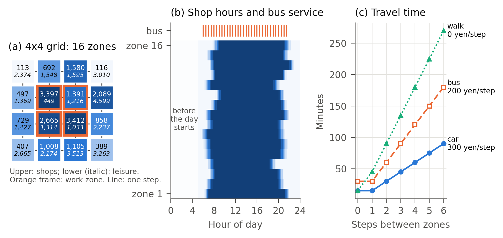
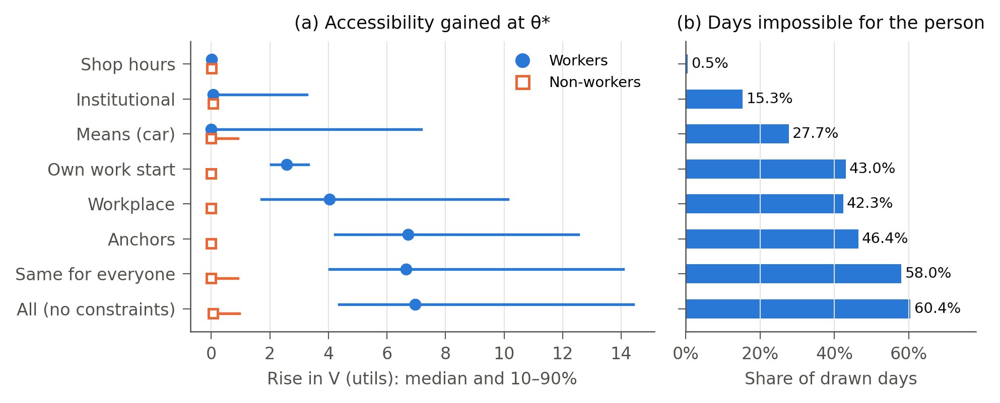

**Half-week post.** It follows the [weekly post of 11 November](/phd/2026-11-11-weekly-progress), which ended with the new estimate converged and cost negative. The full weekly post follows on Wednesday.

> [!warning] Work in progress
> Every number comes from a run log or a script output. Every run reported here is finished. **Update 17 November:** the manuscript is now a full draft (v1), Section 7 below.

> [!note] Case study numbers kept internal (19 November)
> While Paper A is under review, the case study's estimates, policy results, accessibility map and the results deck are kept in internal notes and are no longer shown here. The synthetic (toy) results in Section 2 stay public.

## 1. In short

**Every run planned for Paper A is now finished.** The three parts are:

| Part | Question | Status |
|---|---|---|
| Synthetic experiments (Paper A, Section 5) | Is sharing one graph affordable, is the estimator trustworthy, and what is lost without constraints? | all runs done |
| Case study, estimate (Section 6) | The model with each person's own constraints, on the Higashihiroshima survey | converged, robust standard errors, simulated against the diary |
| Case study, policy simulation (Section 6) | One policy per kind of constraint: who it reaches, welfare, accessibility | three scenarios run, direction checks pass |

- **Synthetic:** without constraints, 60% of the days the model proposes are impossible for the person; the missing rules are absorbed into the parameters (cost even changes sign), the bias does not shrink with more data, and a policy on a missing rule gets a predicted response of exactly zero.
- **Estimate:** converged with robust standard errors; cost negative and clearly identified, every travel time coefficient negative, values of time in the range of the national guideline values.
- **Policy:** three scenarios, one per kind of constraint; each moves only the persons it reaches, in the expected direction.
- **Manuscript (17 November):** the whole of Paper A is written as a first full version (v1): abstract, seven sections and the proofs.
- **Learning (in progress):** the roadmap is established as the main guide, kept flexible, with two deadlines (game theory study camp, 12 December; ISTTT extended abstract, 15 January).

## 2. Synthetic experiments (Paper A, Section 5)

### The setup

**The grid replaces the data, not the code.** The synthetic data pass through the case study's estimator unchanged: the same graphs, masks, gradient and optimizer.

- A 4x4 grid; car, bus and walk.
- Shops are dense in the centre and leisure sits at the edge; shop hours differ by zone; buses run every 30 minutes from 06:00 to 22:00.
- Half the persons work, each with their own workplace, start and duration; 60% may drive.
- The true parameters $\theta^*$ are set by hand.

### Cost: sharing one graph is what makes it affordable

- **One graph per person** is 7.6 times slower per evaluation at 300 persons, with 51 times the edges.
- **Each class swept only within its space-time prism** (the standard restriction to reachable states, lossless) is 3.4 times faster at 3,000 persons on the 8x8 grid.
- **Own schedules for every worker** multiply the number of groups by 25 to 50, but the cost only by 1.2 to 1.7.
- Every grouping (one graph per person, per type, pruned) gives the same likelihood to 1e-14, and a control that drops one mask does not. That agreement is what makes the timing comparison fair.

### Recovery: the estimator returns $\theta^*$

Fitted from half of $\theta^*$, trust-region Newton with the exact Hessian, 63 free parameters.

| Persons | Mean $z^2$ | $\lvert z\rvert > 2$ | RMSE | Median SE | Wall time |
|---|---:|---:|---:|---:|---:|
| 300 | 1.09 | 3 of 63 | 0.152 | 0.034 | 47 s |
| 1,000 | 0.73 | 0 of 63 | 0.119 | 0.017 | 93 s |
| 3,000 | 0.80 | 1 of 63 | 0.056 | 0.011 | 329 s |

- $z$ = (estimate - $\theta^*$) / SE. A mean $z^2$ near 1 means recovery; about 3 values above 2 are expected by chance.
- **Caveat:** these $z$ values come from the grid before the bus timetable was added. The fits with the timetable have no standard errors yet and are read by RMSE.

### With and without constraints

The model without constraints is an activity-based model with a universal choice set. Lifting a rule only removes it, so every observed day stays feasible in every model.

| Element | With | Without |
|---|---|---|
| 24-hour day, travel times, a required work episode and its duration, start and end at home | kept | kept |
| **Institutional:** shop hours, bus timetable | kept | lifted |
| **Means:** car and licence | kept | lifted (everyone may drive) |
| **Anchors:** workplace, own work start | kept | lifted (work anywhere, start 06:00 to 10:00) |

**This comparison is synthetic only.** The case study estimates the model with constraints alone (decided 13 November).

### Stage 1: what the constraints remove, at $\theta^*$

- Without constraints, **60% of drawn days are impossible for the person** who draws them.
- Anchors bind most (46%), then the car (28%), then the institutional rules (15%); shop hours alone barely bind (0.5%).
- The same rules for everyone are almost as bad as none (58%): the rules that matter differ between persons.

### Stage 2: fitted on the same days, tested on new persons

Fitted on 1,000 persons, tested on 1,970 persons never used in fitting.

| Model | Held-out LL per person | Trips per worker | Car trips by persons without a car | Impossible days |
|---|---:|---:|---:|---:|
| Truth ($\theta^*$) | -5.78 | 2.62 | 0% | 0% |
| With constraints | -5.82 | 2.65 | 0% | 0% |
| Without institutional | -6.13 | 2.62 | 0% | 12% |
| Without means | -6.37 | 2.63 | 68% | 19% |
| Without anchors | -8.63 | 2.61 | 0% | 49% |
| Without constraints | -9.17 | 2.61 | 69% | 58% |

**Aggregate trips cannot tell the models apart; feasibility and fit can.**

### The missing rules are absorbed into the parameters

"Could not" is read as "did not want".

| Parameter | $\theta^*$ | With | Without |
|---|---:|---:|---:|
| Car constant | -3.00 | -2.93 | -3.96 |
| Bus constant | -4.00 | -3.99 | -5.68 |
| Walk constant | -3.00 | -2.97 | -4.16 |
| Cost, per yen | -0.0010 | -0.0005 | **+0.0004** |
| Home rate, 07:00 | 0.020 | 0.013 | -0.058 |

- Travel looks unattractive, because persons without a car never drive.
- Mornings look unattractive, because nobody may start work before their own start.
- **The cost coefficient changes sign.** That is the same symptom the case study showed before commutes were made free of cost (11 November post), here produced on purpose.

- (a) With constraints the estimator stays within its standard errors at every size.
- (b) to (d) Without constraints, the travel parameter error stays at 0.85 to 0.92 from 300 to 3,000 persons: **structural, not small-sample**.

### Policy response: no rule, no response

- A model without a rule predicts **exactly zero** response to a policy that changes that rule.
- The rules it keeps it still gets wrong: the size is 0.4 to 2.2 times the truth, and the correlation with who gains is -0.15 to 0.90.
- With constraints the correlation is 0.96 to 0.998.

### Section 5 in four lines

1. **Affordable:** one shared graph instead of one per person; the cost grows slowly with persons and with differing schedules.
2. **Trustworthy:** $\theta^*$ is recovered within its standard errors from 300 to 3,000 persons.
3. **What the constraints remove:** 60% of the days a model without them proposes are impossible.
4. **What goes wrong without them:** worse held-out fit, absorbed parameters (cost with the wrong sign), a bias that stays, and no response to a policy on a missing rule.

The nine small checks of the implementation (Section 4) all pass. They stay in the technical report, not in the manuscript.

## 3. The case study: estimate (Section 6)

The estimate is the one reported on 11 November. New since then: **robust standard errors and the second-order check at the estimate** (12 November).

- **Converged:** the exact Hessian at the estimate has all eigenvalues positive and a Newton decrement near zero, so it is a maximum.
- **Signs:** cost negative and clearly identified; every travel time coefficient negative; values of time for non-commute trips in the range of the MLIT private-trip values.
- **Computation:** 4 shared graphs, 872 evaluation groups, 432 s per evaluation on 24 processes.

**Simulation with the estimated parameters against the diary:** work and home start times and time at home and at work fit closely, and workers' public transport commute fits, out and home. The largest gap is workers as car passengers; there are also too many simulated returns home just before midnight (the model day ends at home at 24:00), and shopping too late in the evening.

## 4. The case study: policy simulation (analysis)

> [!note] Update 17 November
> The policy runs are kept as analysis. In the manuscript the case study is the estimate and accessibility; the three changes appear only as a short illustration of how accessibility responds when one constraint of each kind changes (Section 7 below).

$\theta$ frozen at the 11 November estimate, full sample, exact model expectations. The base run reproduces the estimation's log-likelihood exactly.

| Policy | Kind of constraint | Reaches | Direction check |
|---|---|---|---|
| Shops close 2 h later | institutional | everyone | pass |
| Drivers aged 75+ give up the car | means | drivers aged 75+ | pass |
| Work starts 60 min later | anchor | workers | pass |

- **Each rule moves only the persons it reaches.** The others move by at most 2e-14.
- **Accessibility** is the logsum $V(x_0)$, the value of a person's whole day at the estimated parameters, mapped by home zone at the base and as the change under each policy (added 17 November; kept internal while the paper is under review).

## 5. Learning

**Status: in progress.** On 14 November the learning was reorganised into one order (the mathematical foundations as the main lane, the roadmap stages 0-6 as the content), with two deadlines: the game theory study camp (Sat 12 December) and the ISTTT extended abstract (Fri 15 January). The schedule was revised again on 16 and 18 November; the current version is in the [19 November post](/phd/2026-11-19-weekly-progress).

- **In progress:** linear algebra (MML chapter 2), with a section-by-section reading companion and a learn-guide deck.

## 6. Paper A manuscript: full draft v1 (16 to 17 November)

The whole manuscript now exists as a first full version, written from the results above and reviewed section by section. It runs to 42 pages in the journal's single-column preprint layout (about 9,600 words of main text, 7 figures, 7 tables), with no placeholders left.

| Part | What changed |
|---|---|
| Abstract | written (222 words, the journal allows 250), built around the one claim: persons whose constraints differ can share one computation without losing any of them |
| 1 Introduction | frozen as v1 on 16 November |
| 2 Literature review | rewritten as one story without subsections (constraints in activity-based models, then dynamic discrete choice, then the three ways applied models pay for constraints that differ, then constraint versus preference); 5 pages down to 3 |
| 3 Model | state, action, transition and utility written as formulas; "choice probabilities" instead of "policy"; the classification of constraints as one table, with where each kind is used |
| 4 Heterogeneous constraints on a shared graph | seven subsections down to four, built around the embedding theorem; a figure of the theorem (one person's graph mapped into the shared graph by a mask) and a figure that summarises which result allows which step of the computation; 10 pages down to 8 |
| 5 Numerical experiments | written from the synthetic results (cost, recovery, what is lost without constraints) |
| 6 Case study | the 11 November estimate with the application's utility function written out, the sample at each stage, the fit against the diary, and accessibility by home zone |
| 7 Discussion | written: what generalises, limits (anchors treated as constraints, as in time geography), further work |
| Appendix | the proofs rewritten with the mathematics shown step by step; the second appendix removed |

**Decisions this week:**
- **No policy simulation section.** The case study is the estimate and accessibility; how accessibility responds when one constraint of each kind changes is a short illustration inside it.
- **Fewer figures in the results:** 14 down to 7 in the main text; the rest go to supplementary material.
- **Anchors are constraints, not preferences,** following time geography (an employer's hours as a coupling constraint, fixed activities as pegs); how fixed they are is stated as an assumption.
- Every mathematical symbol is defined where it first appears; the manuscript was checked against the journal's guide for authors (no length limit; abstract at most 250 words; highlights and the end-of-paper declarations still to write).

**A learning note on the proofs** goes through every proof of the appendix line by line, with what would break each step and a check by hand on a small example.
