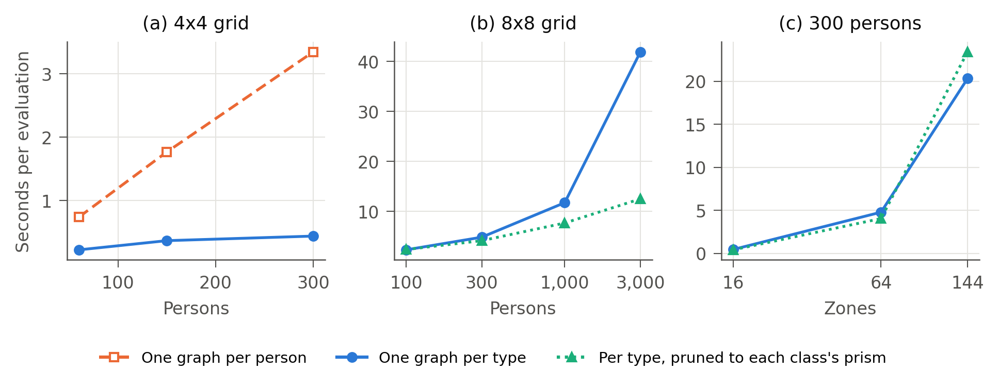
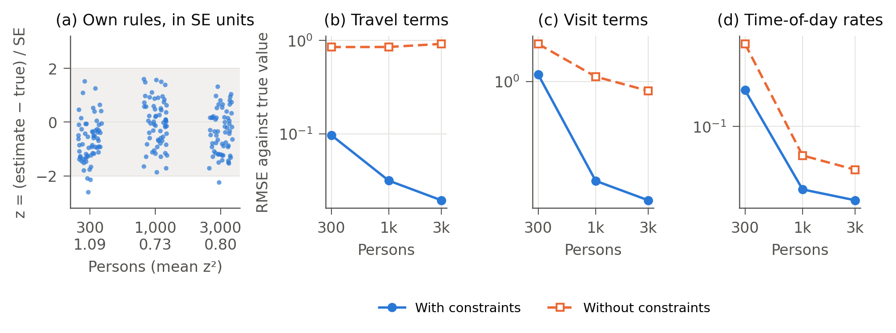
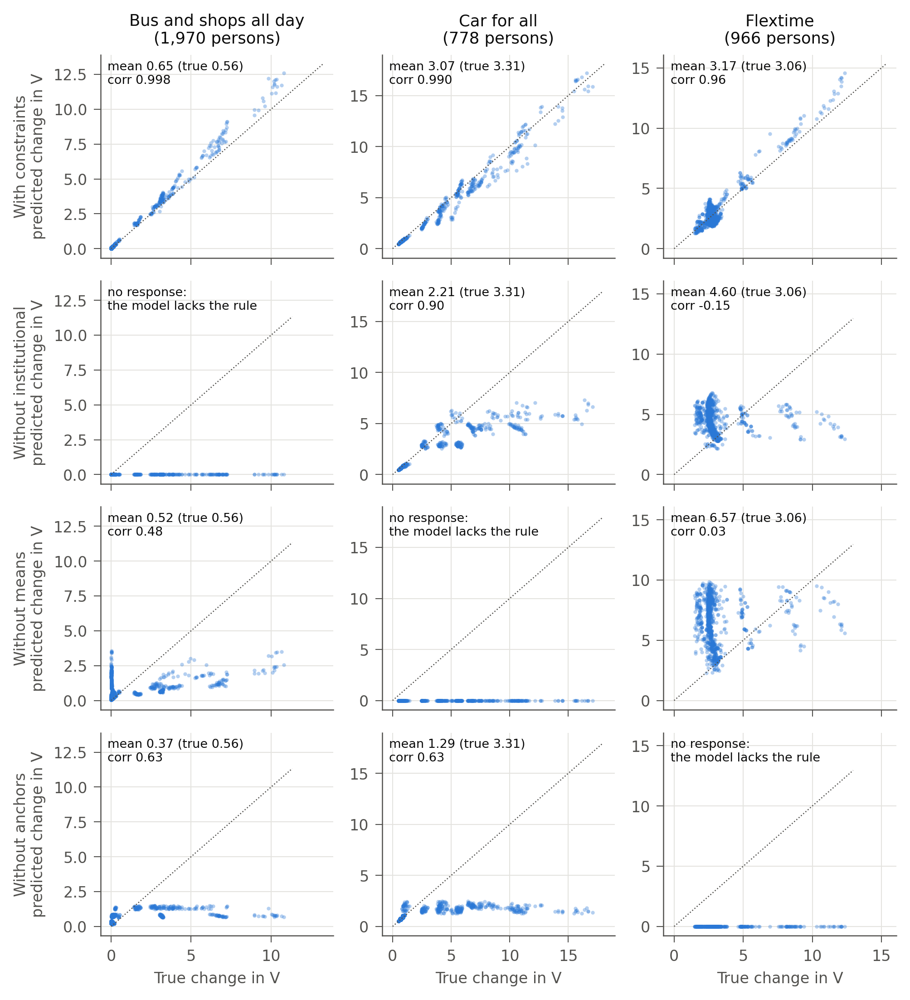
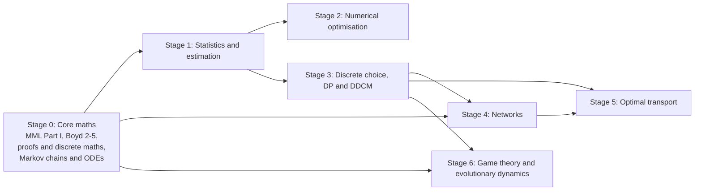
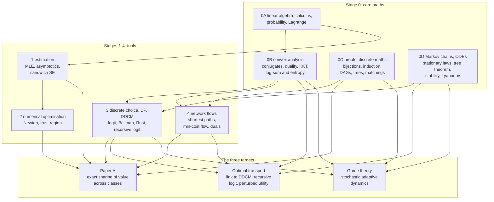

**Half-week post.** It follows the [weekly post of 11 November](/phd/2026-11-11-weekly-progress), which ended with the new estimate converged and cost negative. The full weekly post follows on Wednesday.

> [!warning] Work in progress
> Every number comes from a run log or a script output. Every run reported here is finished; the manuscript text for these results is not written yet.

## 1. In short

**Every run planned for Paper A is now finished.** The three parts are:

| Part | Question | Status |
|---|---|---|
| Synthetic experiments (Paper A, Section 5) | Is sharing one graph affordable, is the estimator trustworthy, and what is lost without constraints? | all runs done |
| Case study, estimate (Section 6) | The model with each person's own constraints, on the Higashihiroshima survey | converged, robust standard errors, simulated against the diary |
| Case study, policy simulation (Section 6) | One policy per kind of constraint: who it reaches, welfare, accessibility | three scenarios run, direction checks pass |

- **Synthetic:** without constraints, 60% of the days the model proposes are impossible for the person; the missing rules are absorbed into the parameters (cost even changes sign), the bias does not shrink with more data, and a policy on a missing rule gets a predicted response of exactly zero.
- **Estimate:** cost negative and clearly identified (robust t -11.9), every travel time coefficient negative, value of time 24 yen per minute by car and 10 by public transport.
- **Policy:** shops closing 2 hours later +2.5 yen per person-day for everyone; drivers aged 75+ giving up the car -215 yen for the 249 persons it reaches; work starting 60 minutes later -589 yen per worker-day. The work-start rule's train drop is mostly the timetable, which does not move with the day.
- **Learning (in progress):** the roadmap is established as the main guide, kept flexible, with two deadlines (game theory study camp, 12 December; ISTTT extended abstract, 15 January).

## 2. Synthetic experiments (Paper A, Section 5)

### The setup

**The grid replaces the data, not the code.** The synthetic data pass through the case study's estimator unchanged: the same graphs, masks, gradient and optimizer.

- A 4x4 grid; car, bus and walk.
- Shops are dense in the centre and leisure sits at the edge; shop hours differ by zone; buses run every 30 minutes from 06:00 to 22:00.
- Half the persons work, each with their own workplace, start and duration; 60% may drive.
- The true parameters $\theta^*$ are set by hand.

### Cost: sharing one graph is what makes it affordable

- **One graph per person** is 7.6 times slower per evaluation at 300 persons, with 51 times the edges.
- **Each class swept only within its space-time prism** (the standard restriction to reachable states, lossless) is 3.4 times faster at 3,000 persons on the 8x8 grid.
- **Own schedules for every worker** multiply the number of groups by 25 to 50, but the cost only by 1.2 to 1.7.
- Every grouping (one graph per person, per type, pruned) gives the same likelihood to 1e-14, and a control that drops one mask does not. That agreement is what makes the timing comparison fair.

### Recovery: the estimator returns $\theta^*$

Fitted from half of $\theta^*$, trust-region Newton with the exact Hessian, 63 free parameters.

| Persons | Mean $z^2$ | $\lvert z\rvert > 2$ | RMSE | Median SE | Wall time |
|---|---:|---:|---:|---:|---:|
| 300 | 1.09 | 3 of 63 | 0.152 | 0.034 | 47 s |
| 1,000 | 0.73 | 0 of 63 | 0.119 | 0.017 | 93 s |
| 3,000 | 0.80 | 1 of 63 | 0.056 | 0.011 | 329 s |

- $z$ = (estimate - $\theta^*$) / SE. A mean $z^2$ near 1 means recovery; about 3 values above 2 are expected by chance.
- **Caveat:** these $z$ values come from the grid before the bus timetable was added. The fits with the timetable have no standard errors yet and are read by RMSE.

### With and without constraints

The model without constraints is an activity-based model with a universal choice set. Lifting a rule only removes it, so every observed day stays feasible in every model.

| Element | With | Without |
|---|---|---|
| 24-hour day, travel times, a required work episode and its duration, start and end at home | kept | kept |
| **Institutional:** shop hours, bus timetable | kept | lifted |
| **Means:** car and licence | kept | lifted (everyone may drive) |
| **Anchors:** workplace, own work start | kept | lifted (work anywhere, start 06:00 to 10:00) |

**This comparison is synthetic only.** The case study estimates the model with constraints alone (decided 13 November).

### Stage 1: what the constraints remove, at $\theta^*$

- Without constraints, **60% of drawn days are impossible for the person** who draws them.
- Anchors bind most (46%), then the car (28%), then the institutional rules (15%); shop hours alone barely bind (0.5%).
- The same rules for everyone are almost as bad as none (58%): the rules that matter differ between persons.

### Stage 2: fitted on the same days, tested on new persons

Fitted on 1,000 persons, tested on 1,970 persons never used in fitting.

| Model | Held-out LL per person | Trips per worker | Car trips by persons without a car | Impossible days |
|---|---:|---:|---:|---:|
| Truth ($\theta^*$) | -5.78 | 2.62 | 0% | 0% |
| With constraints | -5.82 | 2.65 | 0% | 0% |
| Without institutional | -6.13 | 2.62 | 0% | 12% |
| Without means | -6.37 | 2.63 | 68% | 19% |
| Without anchors | -8.63 | 2.61 | 0% | 49% |
| Without constraints | -9.17 | 2.61 | 69% | 58% |

**Aggregate trips cannot tell the models apart; feasibility and fit can.**

### The missing rules are absorbed into the parameters

"Could not" is read as "did not want".

| Parameter | $\theta^*$ | With | Without |
|---|---:|---:|---:|
| Car constant | -3.00 | -2.93 | -3.96 |
| Bus constant | -4.00 | -3.99 | -5.68 |
| Walk constant | -3.00 | -2.97 | -4.16 |
| Cost, per yen | -0.0010 | -0.0005 | **+0.0004** |
| Home rate, 07:00 | 0.020 | 0.013 | -0.058 |

- Travel looks unattractive, because persons without a car never drive.
- Mornings look unattractive, because nobody may start work before their own start.
- **The cost coefficient changes sign.** That is the same symptom the case study showed before commutes were made free of cost (11 November post), here produced on purpose.

- (a) With constraints the estimator stays within its standard errors at every size.
- (b) to (d) Without constraints, the travel parameter error stays at 0.85 to 0.92 from 300 to 3,000 persons: **structural, not small-sample**.

### Policy response: no rule, no response

- A model without a rule predicts **exactly zero** response to a policy that changes that rule.
- The rules it keeps it still gets wrong: the size is 0.4 to 2.2 times the truth, and the correlation with who gains is 0.03 to 0.63.
- With constraints the correlation is 0.96 to 0.998.

### Section 5 in four lines

1. **Affordable:** one shared graph instead of one per person; the cost grows slowly with persons and with differing schedules.
2. **Trustworthy:** $\theta^*$ is recovered within its standard errors from 300 to 3,000 persons.
3. **What the constraints remove:** 60% of the days a model without them proposes are impossible.
4. **What goes wrong without them:** worse held-out fit, absorbed parameters (cost with the wrong sign), a bias that stays, and no response to a policy on a missing rule.

The nine small checks of the implementation (Section 4) all pass. They stay in the technical report, not in the manuscript.

## 3. The case study: estimate (Section 6)

The estimate is the one reported on 11 November ([estimation report](/ddcm/estimate_20261111.html)). New since then: **robust standard errors and the second-order check at the estimate** (12 November), which the 11 November post was updated with.

| | |
|---|---|
| Persons scored | 6,243 |
| Observed decisions | 361,167 |
| Free parameters | 76 |
| Log-likelihood | -34,414.82 |
| Significant at 5% (robust) | 55 of 76 (50 with BHHH) |

- **Converged:** projected gradient 1.3e-6. The exact Hessian at the estimate has all 76 eigenvalues positive (smallest 13.5) and a Newton decrement of 1.4e-8.
- **Computation:** 4 shared graphs, 872 evaluation groups, 432 s per evaluation on 24 processes.

| Parameter | Estimate | Robust t | | Mode | Value of time, yen/min | 95% interval |
|---|---:|---:|---|---|---:|---|
| Car time, per min | -0.0534 | -10.6 | | Car | 24.1 | 17.3 to 30.9 |
| Public transport time | -0.0229 | -4.4 | | Public transport | 10.3 | 5.2 to 15.4 |
| Walk time | -0.0684 | -11.0 | | Walk | 30.8 | 23.3 to 38.3 |
| Bicycle time | -0.0563 | -10.0 | | Bicycle | 25.4 | 18.8 to 32.0 |
| Cost, per yen | -0.0022 | -11.9 | | | | |

- The values of time lie in the range of the MLIT private-trip values (15.2 yen per minute per person, rail manual 2012). Commutes carry no cost in this model, so these are values for non-commute trips.
- One parameter drops below 5% with robust errors: the bus constant for trips outside the city (robust t 1.9).
- Weak directions in the Hessian: public transport time with the 3 pm rates; home and leisure at 9 pm against 10 pm; the afternoon home rates.

**Simulation with the estimated parameters against the diary** (details and figures in the 11 November post and the [full observed vs simulated report](/ddcm/obs_vs_sim_20261111.html)):
- Work and home start times and time at home and at work fit closely; workers' public transport commute fits, out and home.
- **Largest gap: workers as car passengers**, 294 simulated per 1,000 worker-days against 178 as the model encodes the diary (80 in the raw diary).
- Too many simulated returns home just before midnight (the model day ends at home at 24:00), and shopping too late in the evening.

## 4. The case study: policy simulation (Section 6)

$\theta$ frozen at the 11 November estimate; full sample (6,312 persons, 33 with no feasible day); exact model expectations; 1 utility unit = 451 yen ($1/\lvert\beta_{\text{cost}}\rvert$). The base run reproduces the estimation's log-likelihood exactly. [Full policy report](/ddcm/policy_20261113.html).

**One policy per kind of constraint:**

| Policy (kind of constraint) | Reaches | Mean change, yen per person-day | Median | Lose | Direction check |
|---|---|---:|---:|---|---|
| Shops close 2 h later (institutional) | everyone | **+2.5** | +1.8 | 0% (99.7% gain) | pass |
| Drivers aged 75+ give up the car (means) | 249 persons (2 workers) | **-215** | -202 | 100% | pass |
| Work starts 60 min later (anchor) | 2,623 workers | **-589** | -492 | 90% (10% gain) | pass |

- **Each rule moves only the persons it reaches.** The others move by at most 2e-14.
- Work +60: 48 workers lose every feasible day and 13 gain one.

**Behaviour** (change against the base, percentage points of trips):

| Policy | What moves |
|---|---|
| Shops 2 h later | small: shopping stays +0.45 min, shopping in the centre -0.29 pt |
| Licence 75 | car driver -1.5 pt, car passenger +0.5 pt, bicycle, walk and train up a little; non-workers -0.06 trips per day |
| Work +60 | **train -5.0 pt**, car driver +2.2 pt, car passenger +2.5 pt |

**Accessibility at the base** ($V(x_0)$ in yen, medians, against the median non-worker with a car):

| Group | Median |
|---|---:|
| Non-worker, no car | -259 |
| Worker, car | -1,111 |
| Worker, no car | -1,434 |

Workers' accessibility falls with a later work start (workers with a car: -908 for a start at 07:30-08:29, -1,992 for 09:30 or later). Compare only within workers or within non-workers: the work episode itself carries no utility.

### Why train use falls by 5 points under work +60

On the earlier estimate the same rule moved train share by only -0.4 pt, so the -5.0 pt needed checking. Each check ran at a fixed $\theta$, with the reading written before the run.

| Suspect | Result |
|---|---|
| Closed train steps alone | part only: origin-destination pairs with no closures keep only 58% of their train trips |
| Evening home rates (flat from 17:00 to 22:00) | about a fifth (-4.0 pt instead of -4.96 when made flat) |
| Commuter pass rule | ruled out: the commute class reads origin and target, not the clock |
| One work-start window | ruled out: 41-58% of train trips kept in every start hour |
| **The timetable does not move with the day** | **about two thirds** |

| Workers' train share | Base | Work +60, real timetable | Work +60, timetable shifted 60 min |
|---|---:|---:|---:|
| | 22.0% | 13.5% | 19.2% |

Morning and evening alike: with the timetable shifted along with the day, 88% of the morning and 84% of the evening train trips are kept. **Caveat:** the timetable is from 2021-2025, the survey from 2012/2014. The remaining third is the clock position of the day against the time-of-day rates; which part of the timetable carries the two thirds (closed steps, departure-step times, arrival against the fixed work start) is not yet separated.

## 5. Learning

**Status: in progress.** The roadmap is now established: one learning order that is the main guide for learning, kept flexible (lanes may mix, and the order changes when there is a reason).

### One learning order, two deadlines

The learning material was reorganised on 14 November into **one order**, with the foundations as the main lane and two deadlines as side lanes:

| | Date | Target |
|---|---|---|
| Game theory study camp | **Sat 12 December** | present and fully understand Young's "stochastic adaptive dynamics" (Durlauf and Blume 2010) |
| ISTTT extended abstract | **Fri 15 January** | constraints versus preferences in perturbed utility: can a constraint sit inside a generalised entropy or convex programme without breaking the log-sum and its welfare reading, possibly beyond Shannon entropy? |

- **Main lane:** the mathematical foundations (Stage 0), one block at a time in the order each one uses the last: linear algebra, probability and optimisation (*Mathematics for Machine Learning*), then Markov chains and dynamics, then proofs and discrete maths, then convex optimisation. Planned to finish around 3 January.
- **Game theory side lane:** Tadelis chapters 3-6 from the start; the population-games and stochastic-stability lessons (eight lessons, written) only once their foundations are done.
- **ISTTT side lane:** an idea log until the camp, then readings alongside convex optimisation and optimal transport. The track is set up with the question, four hypotheses (my reading, untested) and eight readings in order. **A novelty check** on 27 December and a decision on 3 January: if the proof route finds nothing beyond the existing perturbed-utility papers, a fallback with latent constraint classes.
- **Optimal transport** is on hold as a whole path; its convex-conjugate and entropic lessons return as companions to convex optimisation and to ISTTT.
- About 20-23 hours a week, spread over every day.

### The schedule, week by week (to 15 January)

Two blocks a day: one on the Stage 0 lane, one on the side lane. Game theory runs **in parallel** with Stage 0 from the first day; its population-dynamics lessons start only once the foundations they use are done (0A for potential games, 0D for the dynamics).

| Week | Dates | Stage 0 lane (main) | Side lane | Hours |
|---|---|---|---|---:|
| 0 | 14-15 Nov | 0A: linear algebra (MML ch. 2) | game theory: Tadelis ch. 1-2 (skim), start ch. 3 (normal-form games) | 6 |
| 1 | 16-22 Nov | 0A: analytic geometry, matrix decompositions, vector calculus (MML ch. 3-5) | game theory: Tadelis ch. 3-5 (normal form, dominance, Nash equilibrium) | 23 |
| 2 | 23-29 Nov | 0A: probability, continuous optimisation (MML ch. 6-7), **0A done**; 0D: random walks, stationary distributions and the tree theorem | game theory: Tadelis ch. 6 (mixed strategies), then population and potential games; ISTTT: first reading | 23 |
| 3 | 30 Nov-6 Dec | 0D: ODEs, stability, Lyapunov functions, **0D done** | game theory: revision protocols and mean dynamics; imitation, best-response and logit dynamics; ESS; learning rules; stochastic stability and the tree formula. ISTTT: two readings | 22 |
| 4 | 7-11 Dec | paused for the camp | game theory: selection, speed and path dependence (the target); the deck; dry runs | 14 |
| **camp** | **Sat 12 Dec** | | **present Young's stochastic adaptive dynamics** | |
| 5 | 14-20 Dec | 0C: proofs, functions and induction, DAGs and equivalence relations, matchings, **0C done**; 0B: convex sets | ISTTT: readings on generalised entropy and Fenchel-Young losses | 22 |
| 6 | 21-27 Dec | 0B: convex functions and the conjugate (with the optimal transport conjugate lessons), convex problems | ISTTT: readings; **novelty first check** | 22 |
| 7 | 28 Dec-3 Jan | 0B: duality and KKT, the log-sum and entropy pair, smoothing; **Stage 0 exit check, Stage 0 done** | ISTTT: the one-page claim; **decision: proof route or latent-constraint fallback** | 14 |
| 8 | 4-10 Jan | (Stage 0 finished) | ISTTT as the main lane: entropic transport, perturbed utility and regularised transport, the proof or a counterexample with a numerical check | 22 |
| 9 | 11-15 Jan | | ISTTT: **write the extended abstract**, internal read | 13 |

About 180 hours in total, 20-23 a week at the peak. If a week slips, the skim items go first; the target lessons before the camp and the last two ISTTT weeks are never dropped. From 16 January the main lane moves on to Stages 1, 3, 2 and 4, with the rest of optimal transport and of Tadelis alongside.

### The roadmap

The stages name the **content**; the learning order above sets when each is done. Each stage names the chapters to read and ends with a **gate**: derive the stage's key results on blank paper, without notes. Deep, not complete: one main book per topic, and only the sections named. The day counts are rough guesses, not measurements.

| Stage | Content | Main sources | Days |
|---|---|---|---:|
| **0A** | linear algebra, geometry, matrix decompositions, vector calculus, probability, continuous optimisation | Deisenroth, Faisal and Ong, *Mathematics for Machine Learning*, Part I (ch. 2-7) | 6-7 |
| **0D** | Markov chains (random walks, stationary distributions, the tree theorem); ODEs, stability, Lyapunov functions | Lehman, Leighton and Meyer, *Mathematics for Computer Science*, ch. 20; Strogatz | 3 |
| **0C** | proofs and discrete maths: functions and bijections, induction, directed graphs and DAGs, matchings, counting | Lehman, Leighton and Meyer, *Mathematics for Computer Science* | 3-4 |
| **0B** | convex analysis and duality: convex sets and functions, the conjugate, LP and QP, the dual, KKT | Boyd and Vandenberghe, *Convex Optimization*, ch. 2-5 (selected); Blondel et al. 2020 | 4-5 |
| **1** | statistics and estimation: convergence, MLE, asymptotics, sandwich standard errors | Wasserman; Train ch. 8; Cameron and Trivedi ch. 5; Newey and McFadden 1994 §§2-4; White 1982 | 5-6 |
| **2** | numerical optimisation: Newton, trust region, quasi-Newton (BFGS, SR1) | Boyd §§9.1-9.5; Nocedal and Wright | 3 |
| **3** | discrete choice, dynamic programming, DDCM | Train ch. 2-3; Sutton and Barto ch. 3-4; Powell ch. 3; Rust 1994; Aguirregabiria and Mira 2010 | 5-6 |
| **4** | graphs and network flows: shortest paths, min-cost flow, the transportation problem | Ahuja, Magnanti and Orlin, *Network Flows* | 3-4 |
| **5** | optimal transport, up to its links with DDCM, recursive logit and perturbed utility | a 27-lesson path (Peyré and Cuturi, Santambrogio, Chewi et al., and others) | 10-12 |
| **6** | game theory, up to stochastic adaptive dynamics | Tadelis, *Game Theory: An Introduction*; Sandholm 2015; Durlauf and Blume 2010 | 10 |
| | **total** | | **52-60** |

Stage 0 is the main lane now (in the order 0A, 0D, 0C, 0B, by early January), with game theory and ISTTT alongside it. Stages 1-4 follow from mid-January, Stages 1 and 3 first because Paper A uses them most. Lessons are written for Stage 0, optimal transport and game theory; Stages 1-4 have readings and gates, and their lessons are written before each block starts.

### The mind map: which stage feeds which target

The roadmap says what to read in which order; the map shows which stages each of the three targets draws on. For game theory only the prerequisites are drawn; how it connects to the research comes later.

### In progress

- **Linear algebra (first lesson, MML chapter 2):** reading, with a section-by-section reading companion (what to look for, what is confusing, what can be read fast, checks before moving on) and a learn-guide deck that works the book's own examples one step per slide.

## 6. Status

### Done, in the order it happened

1. **Robust standard errors and the second-order check at the 11 November estimate (12 November).** All eigenvalues positive, Newton decrement 1.4e-8; 55 of 76 parameters significant; cost robust t -11.9.
2. **Synthetic experiments, Section 5 (11 to 14 November).** Cost, recovery, the comparison with and without constraints (stages 1 and 2), absorption, bias against sample size and policy response; all through the production estimator. A technical report (18 pages), the paper's figures (made from saved results only), and an internal results deck.
3. **Policy simulation, in the case study of Section 6 (13 November).** Three scenarios at the full sample, direction checks pass, welfare by who is reached, accessibility at the base; a [report page](/ddcm/policy_20261113.html).
4. **The work +60 train drop traced (13 November):** about two thirds the timetable not moving with the day, about a fifth the evening home rates.
5. **Decisions on Paper A (13 to 14 November):**
   - the comparison with and without constraints is synthetic only; the case study estimates the model with constraints alone;
   - the small implementation checks go to the technical report, not the manuscript; Section 5 leads with cost;
   - the per-class prism restriction is presented as the standard restriction to reachable states, mentioned once, not as a contribution;
   - the policy scope is three rules, one per kind of constraint, with welfare and accessibility.
6. **Code committed:** commute cost paid by the employer (the code the estimate ran with), the memory guard that protects the estimation, and optional BRT in the policy scenarios.
7. **Learning roadmap established (14 November):** one order, used as the main guide and kept flexible, with two deadlines; the ISTTT track set up.

### Doing

- Learning, in progress along the roadmap: MML chapter 2 (linear algebra) now; then MML chapters 3-5 and Tadelis chapters 3-5.

### Error

- **A wrong first conclusion on the work +60 train drop.** I first concluded "not the timetable" from the closed-step check alone. The run with the timetable shifted along with the day showed that was wrong: closed steps are only part; departure-step times and how arrivals fit the fixed work start carry the rest. Corrected in the policy report.
- **Three identification problems in the synthetic world**, found on the way to recovery and fixed in the world, not in the estimator: shop time knots with no open shop, a knot with no shopping at all, and collinear zone sizes.
- **One of the small implementation checks was rebuilt:** it now compares equal feature sums between the layered graph and the chains.
- **Recovery standard errors come from the grid before the bus timetable** (see Section 2). Not an error in the results, but a mismatch between the two worlds; either rerun with standard errors on the timetable grid (about 10 minutes) or state it.

### To do

1. **Write Section 5** of the manuscript from the results, in the model's terms.
2. **Move Section 6 of the manuscript to the 11 November estimate** (parameters with robust standard errors, fit figures, computation) and add the policy simulation to it; it still reports the earlier estimate.
3. **Work +60:** separate the timetable parts (one run of about an hour); find what carries the 589 yen loss per worker-day and the remaining third of the train drop; look at residents outside the city, who lose most (-1,347 yen, 97% lose).
4. **Recovery with standard errors on the bus-timetable grid**, if the two synthetic worlds should match.
5. **Workers' car passenger trips** (294 against 178 as encoded): decide whether workers need their own passenger constant, tested at a fixed $\theta$ before any run.
6. Learning, week 1: MML chapters 3-5 and Tadelis chapters 3-5, with their gates.
