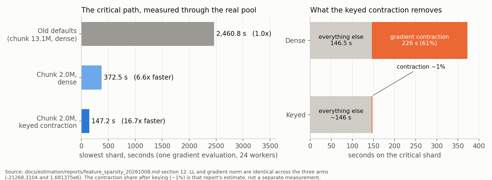
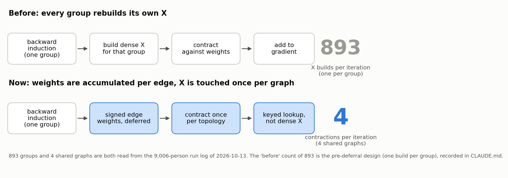
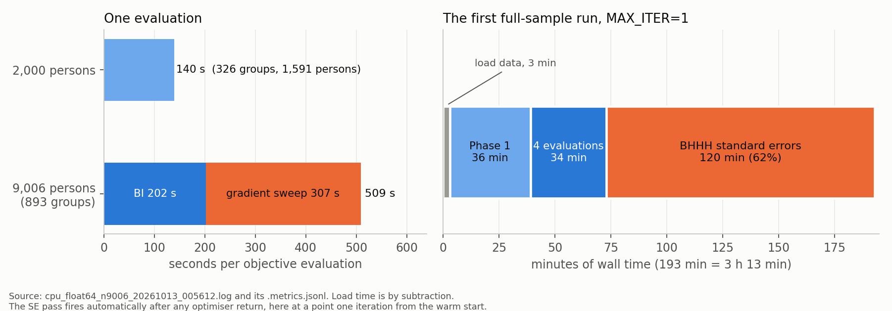

> [!warning] Working recap, 13 October 2026
> Written from the repository, the run logs and the project notes. The production run that follows
> the first full-sample run was still in its first phase when this page was last updated (06:53 on
> 13 October) and had printed no optimiser iteration, so **this page contains no estimation result**.
> The repository is private; the tags below say where each number comes from. Every number carries
> a source tag, and the tags matter:
>
> - **[report]** is in a dated report under `docs/estimation/reports/`, measured with the method it states.
> - **[log]** is read from a run log or its `.metrics.jsonl` on 2026-10-13.
> - **[git]** is read from a commit message or diff.
> - **[notes]** is recorded only in `CLAUDE.md` or the project notes and **was not re-derived here**.
>
> Where this page and the code disagree, the code wins.

## The short answer

One gradient evaluation through the real 24-worker pool went from **2,460.8 s to 147.2 s, 16.7 times
faster**, with the likelihood and the gradient norm identical to every printed digit **[report]**.
It came from two changes, not from a better machine:

1. **A smaller chunk of edges per worker.** The old rule spent memory because memory was available,
   and bigger chunks turned out to be slower. This alone is **6.61 times**.
2. **The gradient is now contracted against a table of distinct feature rows (keyed), once per
   graph, instead of against a dense matrix rebuilt for every group.** This is a further
   **2.53 times**.

Nothing was approximated. The same likelihood, the same gradient, sooner.

On top of that, a full-sample (9,006 persons, 893 groups) objective evaluation now costs about
**509 s** on this machine **[log]**, and a series of correctness and clarity changes made the
optimiser's result worth trusting. Section 6 is the part that is still open.

## 1. What actually changed in the repository

The repository had 151 commits between 4 and 13 October. They fall into six kinds of change, only
the first two of which are about speed.

| Kind | What | Where it is verified |
|---|---|---|
| Speed of the sweep | chunk size as a ceiling, deferred and keyed gradient contraction | [report] feature_sparsity_20261008.md section 12 |
| Speed of everything around it | load balance across workers, a memory regression given back, pooled standard errors | mixed, see section 5 |
| Correctness | four defects that made the gradient or the starting point wrong without any error | [git] commit messages, section 4 |
| Clarity | the legacy parameter block removed, 88 names became 75 | [git] ed31afaa1, 5c69d4247 |
| Honesty of measurement | a machine-readable record of each run, a shared series reader, a record of other users' load | [git] 4ec35065b, d8c77f02a, c4cb18f65 |
| Platform | the CUDA paths deleted, CPU made the platform | [git], CLAUDE.md |

## 2. Why it is faster on CPU

The first useful thing to say is what was **not** the reason. For two days the working belief was
that the slow part was a cache-layout problem in building the feature matrix, and three layout fixes
were tried on that basis. All three lost. The measurement that explains why is simple:

$$X = \frac{\partial u}{\partial \theta}$$

is **1.32% dense**, a median of **one nonzero per edge out of 88 columns** **[report]**. It is a
sparse object stored as a dense one, so no rearrangement of the dense form can help. The cost was
never where the data sat. It was how much of it was written and read.

<video controls loop muted playsinline width="100%" src="figures/dense_vs_keyed.mp4">Animation: a dense feature matrix against the keyed table of distinct rows.</video>

The animation is a schematic. The weights and the matrix pattern are drawn for illustration, and the two claims in its
captions (1.3% dense, 2.53 times) are the measured ones from the report.

Because $X$ does not depend on $\theta$ (the model is linear in the parameters, utility is
$u = X\theta$), every edge carries a feature row that is one of a small set of distinct rows. For the
activity features there are **56,453 distinct keys** **[git, da793fc69]**. A dense $X$ for the largest
of today's four graphs, held whole, would be $61{,}719{,}795 \times 75 \times 8$ bytes, about
**34 GiB**. That is simple arithmetic on the edge count in the 2026-10-13 log, not a measurement of
anything the code did, because the code processes it in chunks and never holds it whole.

### The three steps, and what each is worth

Measured one gradient evaluation at a time through the real pool, 2,000 persons, every arm under one
set of conditions **[report]**:

| Arm | Slowest shard | Speed-up over the old default | Likelihood | Gradient norm |
|---|---:|---:|---|---|
| chunk 13,089,424, dense (the old default) | 2,460.8 s | 1.0 times | -21268.3104 | 1.681375e+06 |
| chunk 2,000,000, dense | 372.5 s | **6.61 times** | -21268.3104 | 1.681375e+06 |
| chunk 2,000,000, keyed | 147.2 s | **16.7 times** | -21268.3104 | 1.681375e+06 |

**Step 1, the chunk size (6.61 times).** `edge_chunk_budget` returned the largest chunk that fit a
memory budget. That is the right shape for a ceiling and the wrong shape for a choice. Its own log
line said so: "~3.9 GiB per process in flight, ~97.5 GiB across the tree" **[git, faad79638]**. The
cost of a large chunk grows faster than the number of workers, so one process holding it is free and
24 processes holding it are not. This is also why a single-process measurement understated the gain
(1.20 times on one shard against 6.61 times in the pool). The rule was changed so that memory is a
ceiling, not a target.

**Step 2, the deferred contraction (the contraction itself fell from 61% of the critical shard to
about 1%) [report].** Look at the second panel above: at the 2,000,000 chunk the gradient
contraction was 226 s of a 372.5 s shard. Keying removes nearly all of it, which is the whole
2.53 times.

**Step 3, why 893 builds became 4.** The next section.

## 3. Why the gradient is cheaper now

The log-likelihood over runs of observed steps has a gradient that can be written as a sum over
edges of a weight times a constant feature row:

$$\nabla_\theta \ell \;=\; \sum_{e} w_e\, X_e, \qquad w_e = \text{(signed forward occupancy of edge } e\text{, from the run entry and exit seeds)}.$$

Two facts make this cheap.

**The sum can be deferred.** $X$ is the same matrix for every group that shares a topology $\tau$.
So

$$\sum_{g} X_{\tau(g)}^{\top} w_g \;=\; \sum_{\tau} X_{\tau}^{\top}\Big(\sum_{g \in \tau} w_g\Big).$$

Each group only accumulates its weights. The contraction against $X$ happens once per topology. The
2026-10-13 log shows **893 groups sharing 4 topologies** **[log]**, so the number of contractions per
iteration is 4. The older design contracted once per group, which the project notes put at roughly
893 builds an iteration **[notes]**. Reading "893" as the group count then and now fits, but the old
code was not re-run to confirm the count.

**The contraction itself can be keyed.** If edge $e$ carries a key $k(e)$ and the distinct feature
rows form a table $\Phi$, then

$$\sum_{e} w_e X_e \;=\; \sum_{k} \Big(\sum_{e:\,k(e)=k} w_e\Big)\Phi_k .$$

The inner sum is a scatter-add over edges, the outer one touches each distinct row once. Both are
exact. The isolated component speed-ups recorded in the commit history (a lookup at 228 times, a
contraction at 66 times on one real topology **[git]**) are real, but they are speed-ups of a piece,
not of an iteration. The whole-pool figure above is the honest one.

### One caution on the deferred form

Deferring is only valid if $X$ really is one matrix for every group in a topology. The gate that
checked this inferred it from parameter names, and it missed a second route into $X$: a $-100$
start penalty written into the work table fed an argmax that chose which activity's time-of-day
column the travel term loads. The result was a gradient wrong by 3.6e-2 **with a bit-identical
likelihood**, and a pooled gradient that varied by 1% to 6.5% between runs **[git, 8767ecb57]**. The
gate now measures the premise instead of inferring it, and the penalty moved into the choice domain
where it belongs (8659247db).

## 4. Correctness changes that matter for the optimiser

A faster wrong gradient is worse than a slow right one. These are the defects found and fixed along
the way. None was visible from the likelihood.

| Defect | Effect | Fix | Source |
|---|---|---|---|
| Work-start floor was a $-100$ in the objective | broke the premise of the deferred form; gradient 3.6e-2 wrong | moved into the domain | [git] 8659247db, 8767ecb57 |
| The keyed module had copied structural knowledge from the utility computer, and the copies drifted within a day | a gradient error of 8.8e-3 under a finite likelihood, hidden by a test fixture whose OD times were all multiples of the time step | the key logic reads the utility computer, and the fixture reaches the branch | [report] section 10 |
| A warm start was matched by row position, not by name | removing a parameter shifted every later value silently | matched by name, retired names refused at non-pinned values | [git] 21efab5c0 |
| Shopping and leisure time-of-day were on the wrong quadrature | a profile phase shift, not noise | midpoint rule, as home already used | [git] c0ecc95d1 |
| The scalar CPU path priced shopping and leisure without the time-of-day knots under the Vastberg spec | the reference path disagreed with the tensor engine | fixed, and a permanent test fails if it recurs | 2026-10-12, `test_scalar_matches_tensor_utility.py` |

The last row was found only because deleting the legacy parameters forced that branch to be
rewritten. A pair of implementations of one formula needs a test that holds them together, and now
has one.

## 5. Speed outside the gradient, and the cost of finding out

- **Load balance across workers.** Setting the parent's share to a ratio of 1.0 on CPU measured
  **1.78 times** (245.7 s to 138.4 s per iteration at 2,000 persons) and **1.74 times** on a free
  machine **[notes]**. Its stated reason had to be corrected: the pool's slowest shard is the
  critical path, and it barely responds to the parent's share.
- **A memory regression given back.** Moving the surplus code behind a seam kept one more
  $(E_c, Z)$ tensor alive, which cost 19.5 GiB across the process tree and made a 2,000-person
  iteration 6.5% slower (2,145.3 s to 2,285.3 s) with a bit-identical likelihood **[git, 351c7996d]**.
  Counting live tensors found it. Reasoning about it had not.
- **Standard errors.** Computing BHHH per-person scores inside the pool took the pass from
  5,826.6 s to 1,965.0 s, **2.97 times** **[notes]**. The workers had already computed the per-person
  scores and thrown the rows away **[git, d6ee06d6f]**.
- **The platform.** The CUDA code paths were deleted on 7 October and the engine is device-agnostic,
  with CPU as the platform. On CPU the gradient is bitwise reproducible across runs, which the GPU
  gradient was not (it varied by 8.4e-5 between runs on MPS) **[notes]**.

Three of the speed numbers in this project were wrong for a day each, and the cause was one method
error: a pool parameter measured in a single process, and a ratio formed from two configurations.
That is why every figure above names its configuration, and why the dedicated report section on it
exists (`feature_sparsity_20261008.md`, section 12).

## 6. The first full-sample run

The first full run was one iteration on 9,006 persons with the standard error pass at the end
**[log]**. It is a cost measurement, not an estimation result.

- **893 groups, 7,464 persons scored** (7,468 with observed steps). Steps dropped: **27.3%** on the first graph
  and 23 to 28% on the others, matching the 2,000-person probe.
- One objective evaluation takes **about 509 s** (541 s the first time), 140 s at 2,000 persons. The
  per-group cost grew from about 0.43 s to about 0.57 s, so scaling groups linearly (the first
  estimate, 340 s) was too optimistic.
- The evaluation is now **40% backward induction, 60% gradient sweep** (202 s and 307 s). Earlier
  figures gave the opposite split on a different configuration. A cost share is only meaningful with
  its device, free-parameter count and whether keyed and chunk were on.
- Phase 1 for 9,006 persons took **36 minutes** (242 s of graph building, 1,912 s of per-group
  backward induction).
- **62% of the 3 h 13 min was the standard error pass.** It fires automatically after any optimiser
  return, and here that return was the iteration limit, so it produced a BHHH matrix at a point one
  step from the warm start. The matrix was badly conditioned (eigenvalues from 6.8 to 1.5e9) and is
  not usable for inference.

### First iterations of the production run (69 free parameters): not yet available

The production run (`cpu_float64_n9006_20261013_062556.log`, started 06:25 on 13 October, warm start
`diag_theta_20261005_1634.csv`) was still building per-group backward induction in its first phase
when this page was last updated, 28 minutes in, so no iteration has printed. The likelihood path, the
line-search trial count, ‖g‖∞ against iteration and the time per iteration will be added here when it
does. **Nothing is claimed about convergence until then.**

## 7. What is not established

- **Convergence.** No run has converged for the current specification. The 2,000-person
  five-iteration test raised the likelihood at every accepted iteration, but the gradient norm
  fell from 0.45 to 0.25 over three iterations and then rose slightly to 0.26. Whether the 69-parameter grid converges, or stalls on the
  sparse hourly shopping and leisure knots as the 5 October run did, is the open question that the
  current run will start to answer.
- **The 5 October failure predates the gradient corrections.** It cannot be read as evidence about
  the current optimiser.
- **The data-matched grid** (47 free parameters) is untested on real data. It is a smaller model,
  not a re-expression of the same one, and its likelihood cost has not been measured.
- **The GPU was not re-measured.** The CPU comparison is against the CPU's own earlier defaults,
  not against a tuned GPU run.
- **The percentages above are specific to this machine** (24 performance cores, 512 GiB) and to the
  2,000-person and 9,006-person caches. They should not be quoted without the configuration.

## 8. Index of sources

| Claim | Source |
|---|---|
| 2,460.8 s, 372.5 s, 147.2 s, 6.61 times, 2.53 times, 16.7 times | `docs/estimation/reports/feature_sparsity_20261008.md` section 12 |
| 1.32% dense, median one nonzero per edge out of 88 | same report, sections 1 to 3 |
| 56,453 keys; the deferred-gate failure; gradient 3.6e-2 wrong | commits da793fc69, 8767ecb57 |
| Chunk of 13,089,424, 3.9 GiB per process, 97.5 GiB across the tree | commit faad79638 |
| 19.5 GiB seam regression | commit 351c7996d |
| Parameter vector 88 to 75; about 12,000 and 4,581 lines deleted | commits ed31afaa1, d50f0b9c7, 5c69d4247 |
| 893 groups, 4 topologies, 509 s per evaluation, 2,153.9 s Phase 1, 7,181 s BHHH | `results/estimation_results/cpu_float64_n9006_20261013_005612.log` |
| LPT ratio 1.78 times and 1.74 times; pooled BHHH 2.97 times; GPU run-to-run variation | `CLAUDE.md` and project notes only, not re-derived here |

## Where this sits

- It is the computation behind link 9 of [[paper-a|Paper A]]: the case study has to run at full
  sample before it can show anything.
- The platform changed during this work. The Master's thesis was built GPU-first
  ([[02-exact-tensor-computation|the tensor implementation]]); the CUDA code paths were deleted on
  7 October and the engine is now device-agnostic with CPU as the platform, which is also what makes
  the gradient bitwise reproducible.
