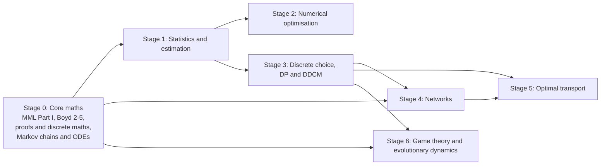
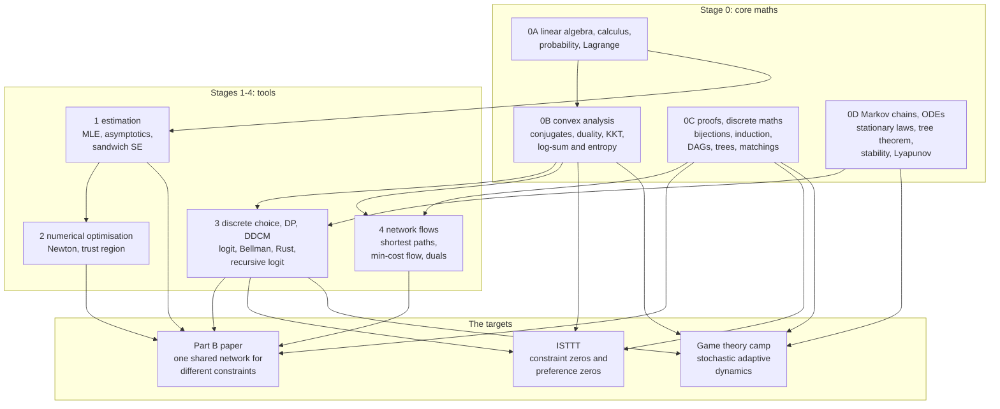

**A living page.** It shows the current study schedule and the full roadmap, and is updated when the plan changes. Weekly progress is in the [weekly posts](/phd/).

## Two deadlines

| | Date | Target |
|---|---|---|
| Game theory study camp | **Sat 12 December 2026** | present and fully understand Young's "stochastic adaptive dynamics" (Durlauf and Blume 2010, pp. 325-332) |
| ISTTT extended abstract | **Fri 15 January 2027** | constraints versus preferences in perturbed utility: can a constraint be built into a generalised entropy or a convex choice problem without breaking the log-sum and its welfare reading, and where do the zeros of a dynamic choice model come from? (2,000-3,000 words, at most 6 pages) |

## How the plan works

- **What to study:** before a deadline, only what that deadline needs, chosen backward from the target (the camp presentation, the ISTTT question, the Part B paper's proofs).
- **Concept units lead; maths comes in as "math stops".** Each week is organised by concept units: one idea to understand (for example Nash and mixed strategies, entropy as counting, choice as a convex programme), each with one driving text (Tadelis, Sandholm, Young, Wilson, the ISTTT readings, the Part B paper). I read the driving text first. When it uses maths I do not have yet, I stop at that page, learn the minimum that page needs (15 minutes to 2 hours), and go back to the text. The same topic can be pulled again later at more depth.
- **Concepts deep, procedures light:** ideas used for years (entropy, multipliers as prices, the log-sum, stationary distributions, stability) are studied until they are obvious; procedures a computer does are worked once by hand.
- **Who waits sets the depth:** when someone is waiting (a review, a meeting), learn to explain it first and derive it later.
- **Checks:** each unit ends with a gate: derive the key results on blank paper, without notes. Every math stop is logged, together with what a unit did not need, so the gaps can be filled after 15 January.
- **Running examples from my own work:** the Part B paper's small example (one shared network, a mask, the main theorem checked by hand), a four-option example for the ISTTT question, and Young's two-strategy coordination game for the camp.
- About 20-23 hours a week; about 180 hours to 15 January.

*History:* 14 November, first version (all basics before the targets); 16 November, revised to "only what each deadline needs"; 18 November, the order rule (explain first when someone waits); 19 November, the Part B paper's proofs moved forward for the supervisor's review; 20 November, Wilson's *Entropy in urban and regional modelling* (1970) added as the classic background on entropy for the ISTTT question, and the whole plan reorganised into concept units with math stops; 24 November, week 1 slipped (a holiday and the revision of the Part B paper after the supervisor's review), so some camp material moved to week 3 and a few lower-priority items were cut (two skim chapters dropped, one reading moved to the ISTTT weeks, two maths topics moved after 15 January).

## The schedule, week by week

### Phase I: to the game theory camp

The chain behind Young's entry: strategic reasoning (Nash, mixed strategies) → populations and how they move → logit choice as a dynamic → noise and the long run → selection, speed and path dependence.

| Week | Dates | Concept units (driving texts) | Maths pulled in at the page | Hours |
|---|---|---|---|---:|
| 0 | 14-15 Nov | | linear algebra (MML ch. 2) | 6 |
| 1 | 16-22 Nov | finish linear algebra ch. 2; **the Part B paper's proofs, explain level, for the supervisor's review**; game theory: Tadelis ch. 1-2 (skim with the deck), ch. 3-4 (normal-form games, dominance) | | 20 |
| 2 | 24-29 Nov (Mon 23 holiday; Part B paper revision) | game theory: finish Tadelis ch. 4; ch. 5-6 (Nash equilibrium, mixed strategies); population games and potential games (Sandholm) | probability: the basic rules (MML ch. 6, part) | about 15 |
| 3 | 30 Nov-6 Dec | revision protocols and mean dynamics; evolutionary stability (skim); logit dynamics, read together with **Wilson 1970 ch. 1 and Appendix 1** (entropy as counting; maximising entropy gives the logit); stochastic stability and the tree formula; first draft of the camp slides | flows on the line and Lyapunov functions; Markov chains, gambler's ruin, random walks on graphs; stationary distributions and the tree formula; Lagrange with one constraint (at Wilson's eq. 1.6) | 23 |
| 4 | 7-11 Dec | selection, speed and path dependence (the target); the slides; dry runs | absorbing chains (waiting times); Pólya's urn (path dependence) | 14 |
| **camp** | **Sat 12 Dec** | **present** | | |

### Phase II: to the ISTTT abstract

The chain behind the ISTTT question: entropy (counting, least bias) → choice as a convex programme (perturbed utility) → splitting a choice into steps as induction on a network → the consumer surplus as the conjugate of entropy, and zeros from preferences → constraints with prices → regularised optimal transport and where zeros come from.

| Week | Dates | Concept units (driving texts) | Maths pulled in at the page | Hours |
|---|---|---|---|---:|
| 5 | 14-20 Dec | choice as a convex programme: McFadden and Fosgerau 2012, Caplin, Dean and Leahy 2019, Feng, Li and Wang 2017; **derive the Part B paper's main theorem on blank paper**; three small numerical checks | Lagrange with several and inequality constraints; convex functions; convex sets and the simplex; what a proof is; bijections and induction | 23 |
| 6 | 21-27 Dec | the surplus as the conjugate of entropy, zeros from preferences: Fenchel-Young losses (Blondel et al. 2020), Chikaraishi and Nakayama 2016, the chain rule of entropy (Cover and Thomas ch. 2), Wilson 1970 ch. 2; **first novelty check** | the convex conjugate; subgradients, kinks and flats, where zeros come from | 22 |
| 7 | 28 Dec-3 Jan | constraints with prices: Wilson 1970 ch. 5-6 (policy and capacity constraints; entropy and utility), Chiong, Galichon and Shum 2016, Caplin, Dean and Leahy 2022; **the one-page claim and the decision on the direction** | duality, KKT and sensitivity; the log-sum and entropy pair; smoothing and Fenchel duality; directed graphs and equivalence relations (with the Part B paper's two reductions as worked cases) | 20.5 |
| 8 | 4-10 Jan | regularised optimal transport and where zeros come from: optimal transport and its entropic form, perturbed utility and regularised transport, Fosgerau 2022, Yao and Zhang; **the proof or a counterexample, with a numerical check** | the transport dual | 22 |
| 9 | 11-15 Jan | **write the extended abstract**, internal read | | 13 |

### Phase III: from 16 January

First a half-day gap check: for every math stop taken, did the short version hold up in later units? Only the gaps it finds are filled. Then the rest of the roadmap, also as concept units, in this order: estimation (why the estimates and their standard errors can be trusted); dynamic discrete choice from the Bellman equation to Rust, with **the Part B paper's proofs derived again in full**; how the estimator's solver works; networks and flows; the rest of optimal transport; the rest of game theory. About 39-44 study days at 20 hours a week, to about June 2027.

## The roadmap

The stages name the **content**; the schedule above sets when each is done. Deep, not complete: one main book per topic, and only the sections named. The day counts are rough guesses.

| Stage | Content | Main sources | Days |
|---|---|---|---:|
| **0A** | linear algebra, geometry, matrix decompositions, vector calculus, probability, continuous optimisation | Deisenroth, Faisal and Ong, *Mathematics for Machine Learning*, Part I (ch. 2-7) | 6-7 |
| **0D** | Markov chains (random walks, stationary distributions, the tree theorem); ODEs, stability, Lyapunov functions | Lehman, Leighton and Meyer, *Mathematics for Computer Science*, ch. 20; Strogatz | 3 |
| **0C** | proofs and discrete maths: functions and bijections, induction, directed graphs and DAGs, matchings, counting | Lehman, Leighton and Meyer, *Mathematics for Computer Science* | 3-4 |
| **0B** | convex analysis and duality: convex sets and functions, the conjugate, LP and QP, the dual, KKT | Boyd and Vandenberghe, *Convex Optimization*, ch. 2-5 (selected); Blondel et al. 2020 | 4-5 |
| **1** | statistics and estimation: convergence, MLE, asymptotics, sandwich standard errors | Wasserman; Train ch. 8; Cameron and Trivedi ch. 5; Newey and McFadden 1994 §§2-4; White 1982 | 5-6 |
| **2** | numerical optimisation: Newton, trust region, quasi-Newton (BFGS, SR1) | Boyd §§9.1-9.5; Nocedal and Wright | 3 |
| **3** | discrete choice, dynamic programming, DDCM | Train ch. 2-3; Sutton and Barto ch. 3-4; Powell ch. 3; Rust 1994; Aguirregabiria and Mira 2010 | 5-6 |
| **4** | graphs and network flows: shortest paths, min-cost flow, the transportation problem | Ahuja, Magnanti and Orlin, *Network Flows* | 3-4 |
| **5** | optimal transport, up to its links with DDCM, recursive logit and perturbed utility | a 27-lesson path (Peyré and Cuturi, Santambrogio, Chewi et al., and others) | 10-12 |
| **6** | game theory, up to stochastic adaptive dynamics | Tadelis, *Game Theory: An Introduction*; Sandholm 2015; Durlauf and Blume 2010 | 10 |
| alongside | entropy in transport, the classic (for the ISTTT question) | Wilson, *Entropy in Urban and Regional Modelling* (1970): ch. 1-2, 5-6 and Appendix 1 before 15 January; the rest later | (in the ISTTT weeks) |
| | **total** | | **52-60** |

### Which stage feeds which target

*Drafted with the help of Claude (Anthropic); a study aid, not a finding.*

