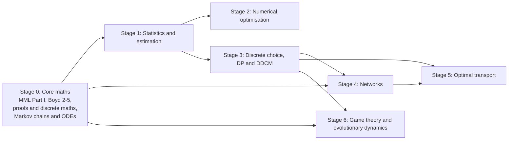

**A living page.** It shows the current study schedule and the full roadmap, and is updated when the plan changes. Weekly progress is in the [weekly posts](/phd/).

## Two deadlines

| | Date | Target |
|---|---|---|
| Game theory study camp | **Sat 12 December 2026** | present and fully understand Young's "stochastic adaptive dynamics" (Durlauf and Blume 2010, pp. 325-332) |
| ISTTT extended abstract | **Fri 15 January 2027** | constraints versus preferences in perturbed utility: where do the zeros of a dynamic choice model come from? (2,000-3,000 words, at most 6 pages) |

## How the plan works

- **What to study:** before a deadline, only what that deadline needs, chosen backward from the target (the camp presentation, the ISTTT question, Paper A's proofs). The rest of the basics is studied after 15 January, in book order.
- **In what order:**

| Situation | Order |
|---|---|
| there is time until the target | basics first |
| someone is waiting now (a review, a meeting) | learn to explain it first, derive it later |
| nothing is waiting | book order, after 15 January |

- **Checks:** each block ends with a gate: derive the key results on blank paper, without notes.
- **Running examples from my own work:** Paper A's small example (one shared network, a mask, the main theorem checked by hand) and a four-day example for the ISTTT question.
- About 20 hours a week; about 177 hours to 15 January.

*History:* 14 November, first version (all basics before the targets); 16 November, revised to "only what each deadline needs"; 18 November, the order rule above; 19 November, Paper A's proofs moved forward for the supervisor's review.

## The schedule, week by week

### Phase I: to the game theory camp

| Week | Dates | Basics | Alongside | Hours |
|---|---|---|---|---:|
| 0 | 14-15 Nov | linear algebra (MML ch. 2) | | 6 |
| 1 | 16-22 Nov | finish linear algebra ch. 2; determinants, eigenvalues and eigendecomposition (MML ch. 4, parts) | game theory: Tadelis ch. 3-4 (normal-form games, dominance); **Paper A's proofs, explain level, for the supervisor's review** | 20 |
| 2 | 23-29 Nov | probability (MML ch. 6, parts); random walks, stationary distributions and the tree theorem; gradients and Jacobians (MML ch. 5, parts) | game theory: Tadelis ch. 5-6 (Nash equilibrium, mixed strategies) | 23 |
| 3 | 30 Nov-6 Dec | differential equations, stability, Lyapunov functions | game theory: population and potential games, revision protocols and mean dynamics, imitation, best response and logit dynamics, evolutionary stability, learning rules (skim), stochastic stability and the tree formula | 23 |
| 4 | 7-11 Dec | (paused) | game theory: selection, speed and path dependence (the target); the presentation; dry runs | 14 |
| **camp** | **Sat 12 Dec** | | **present** | |

### Phase II: to the ISTTT abstract

| Week | Dates | Basics | Alongside | Hours |
|---|---|---|---|---:|
| 5 | 14-20 Dec | Lagrange multipliers and convexity; inner products; what a proof is; functions and induction; convex sets | ISTTT readings: McFadden and Fosgerau 2012, Caplin, Dean and Leahy 2019, Feng, Li and Wang 2017; **derive Paper A's main theorem on blank paper**; three small numerical checks | 23 |
| 6 | 21-27 Dec | convex functions and the convex conjugate; convex problems (skim) | ISTTT readings: Fenchel-Young losses (Blondel et al. 2020), Chikaraishi and Nakayama 2016; the chain rule of entropy; **first novelty check** | 22 |
| 7 | 28 Dec-3 Jan | duality and KKT; the log-sum and entropy pair; smoothing; directed graphs and equivalence relations (with Paper A's two reductions as worked cases) | ISTTT: Chiong, Galichon and Shum 2016, Caplin, Dean and Leahy 2022; **the one-page claim and the decision on the direction** | 18.5 |
| 8 | 4-10 Jan | | ISTTT as the main lane: optimal transport and its entropic form, perturbed utility and regularised transport; **the proof or a counterexample, with a numerical check** | 22 |
| 9 | 11-15 Jan | | ISTTT: **write the extended abstract**, internal read | 13 |

### Phase III: from 16 January

The basics skipped before the deadlines come first. Then the roadmap stages below in the order 1, 3, 2, 4, with Paper A's proofs derived again in full alongside Stage 3. About 39-44 study days at 20 hours a week, to about June 2027.

## The roadmap

The stages name the **content**; the schedule above sets when each is done. Deep, not complete: one main book per topic, and only the sections named. The day counts are rough guesses.

| Stage | Content | Main sources | Days |
|---|---|---|---:|
| **0A** | linear algebra, geometry, matrix decompositions, vector calculus, probability, continuous optimisation | Deisenroth, Faisal and Ong, *Mathematics for Machine Learning*, Part I (ch. 2-7) | 6-7 |
| **0D** | Markov chains (random walks, stationary distributions, the tree theorem); ODEs, stability, Lyapunov functions | Lehman, Leighton and Meyer, *Mathematics for Computer Science*, ch. 20; Strogatz | 3 |
| **0C** | proofs and discrete maths: functions and bijections, induction, directed graphs and DAGs, matchings, counting | Lehman, Leighton and Meyer, *Mathematics for Computer Science* | 3-4 |
| **0B** | convex analysis and duality: convex sets and functions, the conjugate, LP and QP, the dual, KKT | Boyd and Vandenberghe, *Convex Optimization*, ch. 2-5 (selected); Blondel et al. 2020 | 4-5 |
| **1** | statistics and estimation: convergence, MLE, asymptotics, sandwich standard errors | Wasserman; Train ch. 8; Cameron and Trivedi ch. 5; Newey and McFadden 1994 §§2-4; White 1982 | 5-6 |
| **2** | numerical optimisation: Newton, trust region, quasi-Newton (BFGS, SR1) | Boyd §§9.1-9.5; Nocedal and Wright | 3 |
| **3** | discrete choice, dynamic programming, DDCM | Train ch. 2-3; Sutton and Barto ch. 3-4; Powell ch. 3; Rust 1994; Aguirregabiria and Mira 2010 | 5-6 |
| **4** | graphs and network flows: shortest paths, min-cost flow, the transportation problem | Ahuja, Magnanti and Orlin, *Network Flows* | 3-4 |
| **5** | optimal transport, up to its links with DDCM, recursive logit and perturbed utility | a 27-lesson path (Peyré and Cuturi, Santambrogio, Chewi et al., and others) | 10-12 |
| **6** | game theory, up to stochastic adaptive dynamics | Tadelis, *Game Theory: An Introduction*; Sandholm 2015; Durlauf and Blume 2010 | 10 |
| | **total** | | **52-60** |

### Which stage feeds which target

*Drafted with the help of Claude (Anthropic); a study aid, not a finding.*

